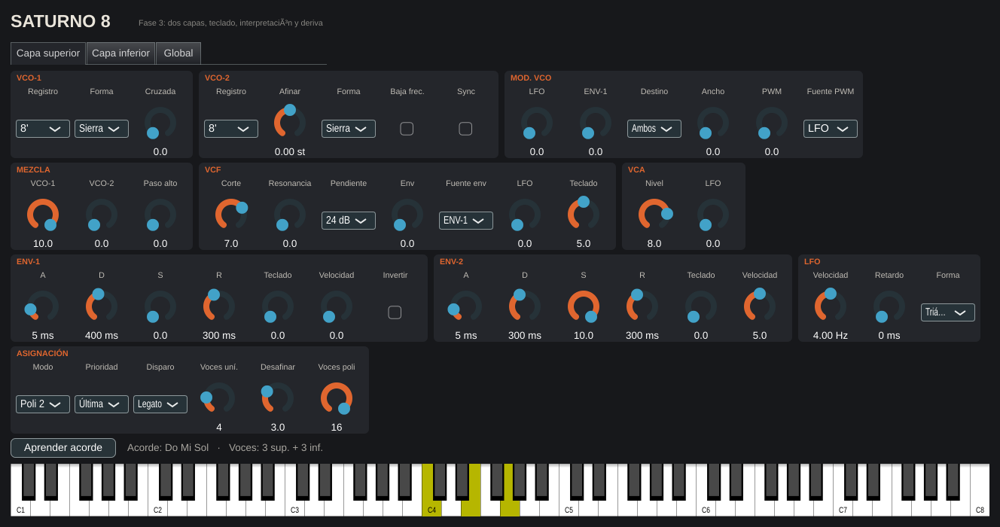
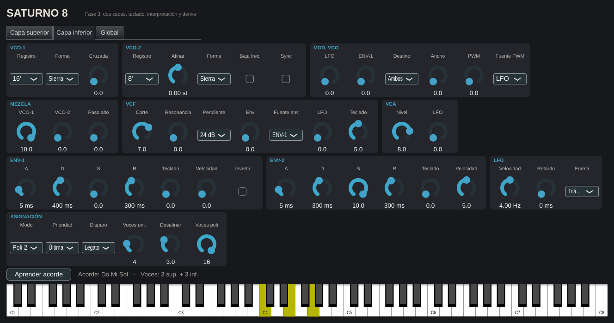
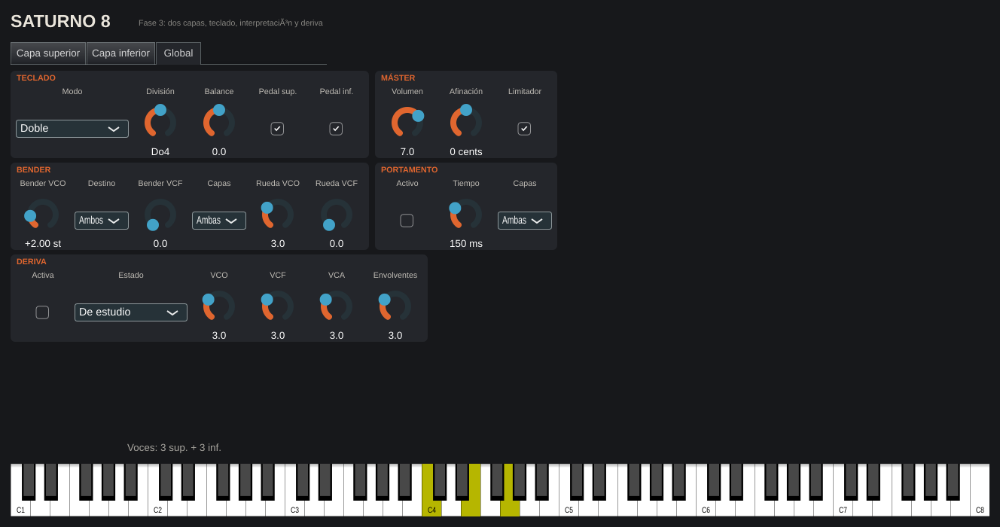

# Saturno 8



Sintetizador polifónico de estilo analógico de principios de los 80, con dos capas, arpegiador y efectos.
Diseño, nombre, sonidos y presets originales; la arquitectura se inspira en los grandes polifónicos de 8 voces de la época.
Formatos: VST3, AU (macOS) y app standalone. Plataformas: macOS 10.13+ (Intel y Apple Silicon) y Windows 10+.

## Compilar

Requisitos: CMake 3.22+, y Xcode (macOS) o Visual Studio 2022 (Windows).

```bash
cmake -B build -DCMAKE_BUILD_TYPE=Release
cmake --build build --config Release --parallel
```

Los binarios quedan en `build/Saturno8_artefacts/Release/` (carpetas `VST3`, `AU`, `Standalone`).
Para instalar el plugin en macOS copia `Saturno 8.vst3` a `~/Library/Audio/Plug-Ins/VST3/` y `Saturno 8.component` a `~/Library/Audio/Plug-Ins/Components/`.
En Windows copia `Saturno 8.vst3` a `C:\Program Files\Common Files\VST3\`.

## Hoja de ruta

1. Esqueleto + CI (hecho)
2. Motor de voz y polifonía (hecho)
3. Capas superior e inferior, interpretación y deriva analógica (hecho)
4. Arpegiador y secuenciador
5. Efectos y matriz de modulación
6. Interfaz gráfica
7. Presets, MIDI learn y oversampling

## Motor de voz (fase 2)

Síntesis analógica modelada, sin samples. Cada voz tiene:

- **VCO-1**: registro 16', 8', 4' o 2'; triángulo, sierra, pulso o cuadrada; **modulación cruzada** (FM exponencial desde VCO-2).
- **VCO-2**: registro 16'–2' y afinación fina de ±12 semitonos; senoide, sierra, pulso o ruido; modo **baja frecuencia** (deja de seguir el teclado y hace de segundo LFO para la cruzada); **sync** (VCO-2 se reinicia con cada ciclo de VCO-1).
- **Modulador de los VCO**: LFO y ENV-1 al tono, destino VCO-1, VCO-2 o ambos; ancho de pulso manual y PWM desde el LFO o ENV-1.
- **Mezclador**: nivel de VCO-1 y VCO-2, y **filtro paso alto** de 6 dB.
- **VCF**: paso bajo de **24 dB** (escalera con saturación, autooscila) o **12 dB** (estado variable); corte, resonancia, envolvente (ENV-1 o ENV-2), LFO y seguimiento de teclado.
- **VCA**: nivel y trémolo por LFO.
- **ENV-1** y **ENV-2**: ADSR de curvas exponenciales, seguimiento de teclado (notas agudas, envolventes más cortas) y sensibilidad a la velocidad. ENV-1 se puede invertir.
- **LFO**: senoide, triángulo, sierra, cuadrada o aleatoria (S&H), de 0,05 a 40 Hz, con retardo de entrada.

**Asignación de voces** (16 voces):

| Modo | Qué hace |
|---|---|
| Solo | Monofónico. Prioridad grave, aguda o última; disparo legato (solo redispara si no había teclas pulsadas) o múltiple. |
| Unísono | 1–16 voces en la misma nota, abiertas en estéreo y con desafinación ajustable. |
| Poli 1 | Reparte las notas en rotación: cada nota nueva usa la voz que se soltó hace más tiempo. |
| Poli 2 | Una nota repetida vuelve a su misma voz y se prefieren voces en silencio: legato más limpio. |
| Acorde | Mantén un acorde, pulsa **Aprender acorde** y cada tecla tocará ese acorde transportado. El acorde se guarda con el proyecto. |

También: pedal de sostenido (CC 64), «Voces poli» limita la polifonía, y la interfaz trae un teclado para tocar sin controlador.

La interfaz de esta fase es un panel funcional; la definitiva llega en la fase 6.

`render_demo <carpeta>` genera sonidos de ejemplo en WAV (metales, pad PWM, bajo solo, lead sync en unísono, campanas con cruzada, memoria de acorde y, desde la fase 3, las dos capas en división) y mide cuántas veces más rápido que el tiempo real calcula el motor.

Pruebas: `ctest --test-dir build -C Release`. Captura sin ventana: `cmake -B build -DS8_UI_SNAPSHOT=ON && cmake --build build --target ui_snapshot`.

## Capas, interpretación y deriva (fase 3)

Dos capas completas, **superior** e **inferior**, de 16 voces cada una y con todos sus parámetros propios (osciladores, filtros, envolventes, LFO y asignación). En el panel se elige qué capa se edita con las pestañas.

- **Teclado**: *Entera* (solo la superior), *Doble* (las dos apiladas), *División* (la inferior por debajo del punto de división y la superior desde él) y *División con fundido* (una octava de transición en la que suenan las dos). **Balance** entre capas y **pedal de sostenido** activable por capa.
- **Bender**: rango en semitonos hacia VCO-1, VCO-2 o ambos, barrido del filtro, y a qué capas afecta (superior, ambas o inferior). La **rueda de modulación** añade LFO al tono y al filtro.
- **Portamento**: tiempo de 0 a 5 s y capas a las que se aplica. En modo poli cada voz nueva sale de la última nota tocada; en solo y unísono se desliza en legato.
- **Deriva analógica**: cada voz tiene su propia tolerancia y un paseo lento al azar en la afinación de los VCO, el corte del VCF y el nivel del VCA, y variaciones en los tiempos de las envolventes. El **estado** del instrumento escala todo: *Recién salido*, *De estudio*, *De gira*, *Veterano* y *Al taller*. Para FM cruzada bien afinada, mejor con la deriva apagada.
- **Máster**: volumen, afinación general (±100 cents) y **limitador** de picos.
- MIDI: pitch bend, rueda de modulación (CC 1), sostenido (CC 64) y todas las notas fuera.



