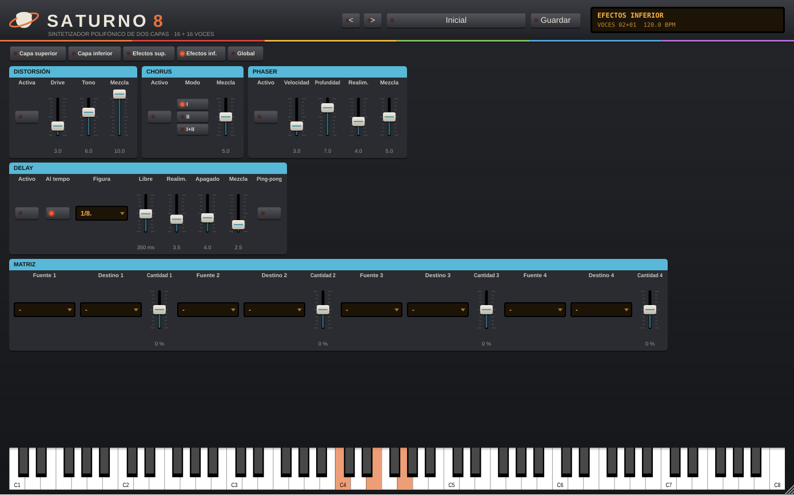

# Saturno 8


Sintetizador polifónico de estilo analógico de principios de los 80, con dos capas, arpegiador y efectos.
Diseño, nombre, sonidos y presets originales; la arquitectura se inspira en los grandes polifónicos de 8 voces de la época.
Formatos: VST3, AU (macOS) y app standalone. Plataformas: macOS 10.13+ (Intel y Apple Silicon) y Windows 10+.

## Compilar

Requisitos: CMake 3.22+, y Xcode (macOS) o Visual Studio 2022 (Windows).

```bash
cmake -B build -DCMAKE_BUILD_TYPE=Release
cmake --build build --config Release --parallel
```

Los binarios quedan en `build/Saturno8_artefacts/Release/` (carpetas `VST3`, `AU`, `Standalone`).
Para instalar el plugin en macOS copia `Saturno 8.vst3` a `~/Library/Audio/Plug-Ins/VST3/` y `Saturno 8.component` a `~/Library/Audio/Plug-Ins/Components/`.
En Windows copia `Saturno 8.vst3` a `C:\Program Files\Common Files\VST3\`.

## Hoja de ruta

1. Esqueleto + CI (hecho)
2. Motor de voz y polifonía (hecho)
3. Capas superior e inferior, interpretación y deriva analógica (hecho)
4. Arpegiador y secuenciador (hecho)
5. Efectos y matriz de modulación (hecho)
6. Interfaz gráfica (hecho)
7. Presets, MIDI learn y oversampling (hecho)

## Motor de voz (fase 2)

Síntesis analógica modelada, sin samples. Cada voz tiene:

- **VCO-1**: registro 16', 8', 4' o 2'; triángulo, sierra, pulso o cuadrada; **modulación cruzada** (FM exponencial desde VCO-2).
- **VCO-2**: registro 16'–2' y afinación fina de ±12 semitonos; senoide, sierra, pulso o ruido; modo **baja frecuencia** (deja de seguir el teclado y hace de segundo LFO para la cruzada); **sync** (VCO-2 se reinicia con cada ciclo de VCO-1).
- **Modulador de los VCO**: LFO y ENV-1 al tono, destino VCO-1, VCO-2 o ambos; ancho de pulso manual y PWM desde el LFO o ENV-1.
- **Mezclador**: nivel de VCO-1 y VCO-2, y **filtro paso alto** de 6 dB.
- **VCF**: paso bajo de **24 dB** (escalera con saturación, autooscila) o **12 dB** (estado variable); corte, resonancia, envolvente (ENV-1 o ENV-2), LFO y seguimiento de teclado.
- **VCA**: nivel y trémolo por LFO.
- **ENV-1** y **ENV-2**: ADSR de curvas exponenciales, seguimiento de teclado (notas agudas, envolventes más cortas) y sensibilidad a la velocidad. ENV-1 se puede invertir.
- **LFO**: senoide, triángulo, sierra, cuadrada o aleatoria (S&H), de 0,05 a 40 Hz, con retardo de entrada.

**Asignación de voces** (16 voces):

| Modo | Qué hace |
|---|---|
| Solo | Monofónico. Prioridad grave, aguda o última; disparo legato (solo redispara si no había teclas pulsadas) o múltiple. |
| Unísono | 1–16 voces en la misma nota, abiertas en estéreo y con desafinación ajustable. |
| Poli 1 | Reparte las notas en rotación: cada nota nueva usa la voz que se soltó hace más tiempo. |
| Poli 2 | Una nota repetida vuelve a su misma voz y se prefieren voces en silencio: legato más limpio. |
| Acorde | Mantén un acorde, pulsa **Aprender acorde** y cada tecla tocará ese acorde transportado. El acorde se guarda con el proyecto. |

También: pedal de sostenido (CC 64), «Voces poli» limita la polifonía, y la interfaz trae un teclado para tocar sin controlador.


`render_demo <carpeta>` genera sonidos de ejemplo en WAV (metales, pad PWM, bajo solo, lead sync en unísono, campanas con cruzada, memoria de acorde y, desde la fase 3, las dos capas en división) y mide cuántas veces más rápido que el tiempo real calcula el motor.

Pruebas: `ctest --test-dir build -C Release`. Captura sin ventana: `cmake -B build -DS8_UI_SNAPSHOT=ON && cmake --build build --target ui_snapshot`.

## Capas, interpretación y deriva (fase 3)

Dos capas completas, **superior** e **inferior**, de 16 voces cada una y con todos sus parámetros propios (osciladores, filtros, envolventes, LFO y asignación). En el panel se elige qué capa se edita con las pestañas.

- **Teclado**: *Entera* (solo la superior), *Doble* (las dos apiladas), *División* (la inferior por debajo del punto de división y la superior desde él) y *División con fundido* (una octava de transición en la que suenan las dos). **Balance** entre capas y **pedal de sostenido** activable por capa.
- **Bender**: rango en semitonos hacia VCO-1, VCO-2 o ambos, barrido del filtro, y a qué capas afecta (superior, ambas o inferior). La **rueda de modulación** añade LFO al tono y al filtro.
- **Portamento**: tiempo de 0 a 5 s y capas a las que se aplica. En modo poli cada voz nueva sale de la última nota tocada; en solo y unísono se desliza en legato.
- **Deriva analógica**: cada voz tiene su propia tolerancia y un paseo lento al azar en la afinación de los VCO, el corte del VCF y el nivel del VCA, y variaciones en los tiempos de las envolventes. El **estado** del instrumento escala todo: *Recién salido*, *De estudio*, *De gira*, *Veterano* y *Al taller*. Para FM cruzada bien afinada, mejor con la deriva apagada.
- **Máster**: volumen, afinación general (±100 cents) y **limitador** de picos.
- MIDI: pitch bend, rueda de modulación (CC 1), sostenido (CC 64) y todas las notas fuera.


## Arpegiador y secuenciador (fase 4)

Cada capa tiene su propio reproductor, con tres modos: *Apagado*, *Arpegiador* o *Secuenciador*. Así se puede, por ejemplo, arpegiar la capa superior mientras la inferior toca una línea de bajo secuenciada.

- **Arpegiador**: patrones *Arpegio* (de grave a agudo), *Salto* (la nota más grave alterna con cada una de las demás), *Orden* (en el orden en que se pulsaron) y *Azar*; dirección arriba, abajo, arriba-abajo o abajo-arriba; de 1 a 4 octavas.
- **Secuenciador**: 16 pasos con nota relativa (±24 semitonos), silencio, **ligadura** y **acento**; de 1 a 16 pasos; recorrido en bucle, ida y vuelta o al azar. La secuencia suena mientras haya teclas pulsadas y se transporta desde la más grave. Los pasos se guardan con el proyecto.
- **Comunes**: figura (1/4, 1/8, 1/8T, 1/16, 1/16T, 1/32), duración de la nota, **swing** (50–75 %), **probabilidad** de cada paso y **enganche** (las notas siguen al soltar; la siguiente tecla tras soltar todo empieza una frase nueva).
- **Tempo**: con el DAW en marcha sigue su tempo y su rejilla; parado o en la app standalone usa el tempo propio (sección Máster) y la primera tecla marca el tiempo.

En el panel, la rejilla **Secuencia** de cada capa: clic en el LED para paso o silencio, arrastrar o rueda sobre la nota para los semitonos (doble clic = 0), **L** para ligadura y **A** para acento. El paso que suena se ilumina.

## Efectos y matriz de modulación (fase 5)

Tres cadenas de efectos: una por capa y otra global, en este orden: capa → efectos de la capa → balance → efectos globales → volumen → limitador.

- **Por capa** (pestañas *Efectos sup.* y *Efectos inf.*):
  - **Distorsión**: drive con recorte suave asimétrico, tono y mezcla.
  - **Chorus** de dos líneas tipo BBD en contrafase, modos I, II e I+II (este último rápido y poco profundo, tipo vibrato).
  - **Phaser** estéreo de 4 etapas: velocidad, profundidad, realimentación y mezcla.
  - **Delay**: al tempo (1/16 a 1/2 con puntillos y tresillos) o libre (20–2000 ms), realimentación, apagado de agudos en la repetición, mezcla y ping-pong.
- **Globales** (pestaña *Global*): **ecualizador** de graves (140 Hz) y agudos (5 kHz) de ±12 dB y **reverb** con tamaño, apagado, predelay y mezcla.
- **Matriz de modulación** por capa, 4 ranuras: fuente → destino con cantidad bipolar (±100 %).
  - Fuentes: LFO, ENV-1, ENV-2, velocidad, teclado, rueda, aftertouch, bender y un valor al azar por nota.
  - Destinos: tono (los dos VCO o cada uno, ±24 st), ancho de pulso, cruzada, nivel de VCO-2, paso alto, corte (±5 octavas), resonancia, nivel y panorama.


## Interfaz (fase 6)

Diseño propio dibujado por código, sin imágenes: panel grafito con franjas de color por familia (osciladores en naranja, filtro y VCA en rojo, envolventes en mostaza, LFO y matriz en verde, teclado y asignación en azul, arpegiador en violeta), faders con capuchón crema y escala, teclas con LED para elegir opciones y una pantalla ámbar con la página, el acorde guardado, las voces que suenan, el tempo y la reducción del limitador.

- **Pestañas**: *Capa superior*, *Capa inferior*, *Efectos sup.*, *Efectos inf.* y *Global*. En las páginas de la capa inferior todo se tiñe de azul para no confundir qué capa se edita.
- **Faders**: arrastrar para mover, doble clic para volver al valor de fábrica; el valor aparece debajo y en una burbuja al arrastrar.
- **Opciones**: las de hasta 5 valores son teclas con LED; las largas (figura del delay, fuentes y destinos de la matriz) usan la pantalla ámbar.
- La ventana se puede redimensionar del 50 % al 200 % manteniendo la proporción; se abre al 80 %.



## Presets, MIDI learn y sobremuestreo (fase 7)

- **Presets**: la barra de la cabecera tiene anterior / siguiente, el nombre (clic = menú) y **Guardar**.
  - **De fábrica**: 14 sonidos de programación propia (Inicial, Metales del anillo, Cuerdas de Titán, Pad pulsante, Bajo Encélado, Lead sincronizado, Campanas de hielo, Arpegio orbital, Secuencia de Febe, Doble: piano y pad, División: bajo y metales, Acorde menor 9, Barrido con ruido y Viejo y desafinado). El DAW también los ve como programas.
  - **Tuyos**: guardan todo el sonido de las dos capas, los efectos, el acorde y las secuencias, en `Documentos/Saturno 8/Presets` como archivos `.s8preset` que se pueden copiar entre Mac y Windows. Cargar un preset no cambia el volumen general, el tempo, la calidad ni el mapa MIDI.
- **MIDI learn**: clic derecho en cualquier control → *Aprender MIDI* y mueve un mando del controlador; *Olvidar MIDI* lo quita. La pantalla avisa mientras espera. El mapa se guarda con el proyecto del DAW.
- **Calidad** (sección Máster): x1, x2 o x4. Con x2 y x4 el motor calcula internamente a doble o cuádruple frecuencia (menos aliasing en sync, cruzada y resonancia alta) a cambio de más CPU. Cambiarla reinicia las voces.

Comprobaciones con `ui_snapshot`: los 14 presets suenan sin NaN a x1 y a x4, y el estado (preset, secuencia y mapa MIDI) se guarda y se recupera igual.
